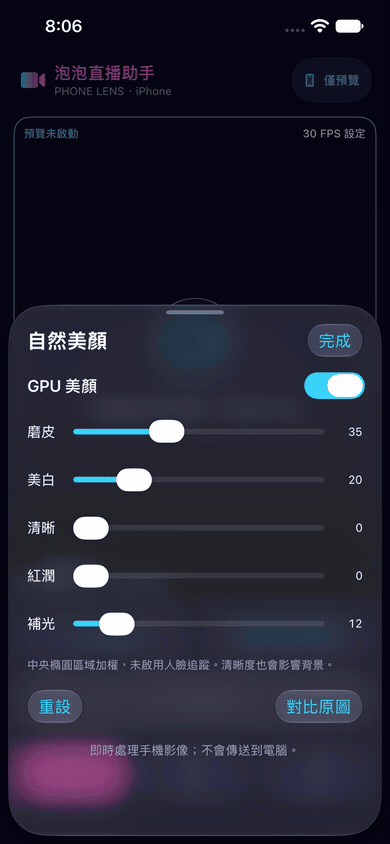

# 泡泡直播助手 v2（iPhoneCam v2）

> v2 由 v1 從頭改寫：Android 端改用 Kotlin、PC 端 .NET 10 + WPF（霓虹 UI）、Media Foundation 虛擬攝影機；另有進行中的原生 iOS 預覽／美顏端。
> 手機鏡頭 → Wi-Fi → PC 虛擬攝影機 → OBS／Discord／Teams 直接選用。
> v1（`iPhoneCam-v1`）已封存凍結，本倉庫為現行開發線。

## iPhone 介面展示



此錄影來自 **iPhone 14 Simulator**，展示首頁、美顏面板、設定與輸出狀態；Simulator 沒有相機，因此不是實拍美顏品質或串流成功證明。若動圖無法播放，可下載 [MP4 錄影](docs/media/iphone-ui-simulator.mp4)。

## 系統架構

```
手機 App（Android，Kotlin）
  Camera2 擷取 → MediaCodec 硬編 H.264／HEVC
      ├─ 控制：TCP 19300（手機監聽，PC 主動連入）
      ├─ 影像：UDP 19302（CUM1 分片＋NACK，抗無線抖動；斷流自動回退 TCP）
      └─ 發現：UDP 信標 19301（每 2 秒廣播 JSON）
              ↓ Wi-Fi（同區網）
PC（C#，Win11，.NET 10）
  iPhoneCam.App（WPF 控制台）→ iPhoneCam.Net（解碼／協定／共享記憶體）
  → iPhoneCam.Source（MF 虛擬攝影機 COM DLL）
              ↓
  OBS／Discord／Teams 選「iPhoneCam」當攝影機

iPhone App（SwiftUI／AVFoundation／Metal，進行中）
  相機最新 BGRA 幀 → Metal 基礎美顏 → 本機預覽
  ※ 尚未串接 CAM1/CUM1、VideoToolbox 編碼或桌面虛擬攝影機
```

一句話分工：**手機是攝影機＋編碼器，PC 是收流端＋大腦**。編碼只在手機做，其餘（解碼、多檔輸出、控制、方向轉正）全在 PC。

## 專案結構

```
iPhoneCam/
├── iPhoneCam.slnx              # PC 端方案（.NET 10）
├── iPhoneCam.App/              # PC WPF 控制台：裝置清單、預覽、參數、統計、霓虹 UI
├── iPhoneCam.Net/              # PC 共用庫（net10.0，無 UI 相依）
│   ├── Cam1Protocol.cs         #   CAM1 訊框＋控制訊息（大端序，凍結）
│   ├── Cam1Client.cs           #   PC 主動連線（正式路徑：手機監聽、PC 連入）
│   ├── Cam1Server.cs           #   PC 監聽版（保留給迴路測試）
│   ├── BeaconListener.cs       #   UDP 信標 19301 監聽＋裝置清單去重
│   ├── UdpVideoReceiver.cs     #   CUM1 UDP 影像：重組＋抖動緩衝＋NACK
│   ├── FfmpegDecoder.cs        #   ffmpeg 子程序解碼（NV12 全尺寸輸出）
│   ├── SharedFrame.cs          #   跨處理程序影格通道（Global MMF，BGRA／NV12）
│   ├── SharedConfig.cs         #   畫布尺寸通道（Global MMF，FrameServer 讀得到）
│   ├── Cam1Stats.cs            #   fps／Mbps／延遲統計
│   ├── Nv12Preview.cs          #   NV12 → 預覽小圖
│   └── AnnexB.cs               #   AVCC ↔ Annex-B
├── iPhoneCam.Source/           # MF 虛擬攝影機 COM DLL（fork 自 smourier/VCamNetSample）
├── AndroidSender/              # Android 發送端（Kotlin：Camera2＋MediaCodec）
│   └── app/src/main/java/com/iphonecam/sender/
│       ├── MainActivity.kt     #   主畫面
│       ├── SenderViewModel.kt  #   狀態：廣播開關、檔位、鏡頭、過熱
│       └── core/               #   Cam1／NetServer／StreamEngine／DeviceCameraCatalog
├── ios/                        # iPhone 原生預覽／美顏原型（SwiftUI＋Metal）
│   ├── PhoneLens/              #   相機、Metal renderer 與 iOS 介面
│   └── tests/                  #   Metal shader 離屏像素測試
├── docs/media/                 # README 的 iPhone Simulator 介面錄影
└── SPEC-v3.md                  # 規格定稿（v3 凍結），含檔位、碼率、濾鏡分工
```

## 傳輸協定

- **CAM1 訊框**（大端序，凍結）：`[MAGIC 4B "CAM1"][型別 1B][時間戳微秒 8B][長度 4B][酬載]`
  - `0x01`＝影像、`0x03`＝控制 JSON（`0x02` 保留）
- **控制走 TCP 19300**（手機監聽、PC 主動連入）：`hello`／`video_params`／`codec_config`／`set_video`／`set_image`／`idr_request`／`orientation`／`udp_ready`／`udp_lost`／`nack`／`net_state`／`video_rejected`。
- **影像走 UDP 19302（CUM1）**：`[0x43554D31][seq u32][tsUs u64][flags 1B][fragIdx u16][fragTotal u16][payload ≤1400B]`，分片重組＋NACK 重送＋抖動緩衝，斷流自動回退 TCP。
- **裝置發現走 UDP 信標 19301**：手機每 2 秒廣播 JSON `{kind:"beacon",name,ip,port,codec,max}`，PC 收集成清單（同 IP 去重、逾時移除）。
- 影像：H.264／HEVC；IDR 前綴 SPS／PPS（HEVC 含 VPS），關鍵幀間隔 2 秒（高檔 1 秒）、無 B 幀、CBR。

## 影像檔位（4:3 原生，CMOS 滿幅不裁切）

| 檔位 | 解析度 | 編碼 | 碼率 |
|---|---|---|---|
| 720P | 960×720 | H.264 | 4 Mbps |
| 1080P | 1440×1080 | H.264 | 8 Mbps |
| 2K | 1920×1440 | HEVC | 16 Mbps |
| 4K | 2880×2160 | HEVC | 32 Mbps |

FPS 可選 30／60。手機過熱自動降碼率；網路變差走 ABR 碼率階梯（PC 回授 `net_state`）。

## 功能

- **PC 控制台**：裝置清單（UDP 信標自動搜尋）＋手動 IP、即時預覽、解析度／FPS 切換、IDR 請求、截圖、統計（fps／Mbps／延遲）。
- **虛擬攝影機**：`MFCreateVirtualCamera`＋自訂 `IMFMediaSource`（NV12），跨處理程序以共享記憶體餵幀；換畫布跟著串流解析度走，斷訊凍結上一幀（不閃彩條）。
- **方向跟隨**：串流維持 sensor 原生方向，手機送 `rot`／`flip`，PC 用 ffmpeg `transpose`／`hflip` 轉正（不重啟編碼）。
- **多鏡頭**：Kotlin 端列舉各鏡頭（含 Samsung 機型對照表），串流中可切換主鏡／超廣角／長焦／前置。
- **保命機制**：session 失敗自動降檔、drain 防重入、過熱降碼率、亮屏＋WiFi 鎖。
- **霓虹 UI**：深紫黑底＋青粉漸層框＋LIVE 藥丸，致敬《主播女孩重度依賴》風格。
- **iPhone 預覽／基礎美顏（進行中）**：SwiftUI 版首頁、設定與幫助；AVFoundation 相機幀經 Metal 處理磨皮、美白、清晰、紅潤、補光。保留 Liquid Glass、原圖對比與重設。詳見 [`ios/README.md`](ios/README.md)。

## 建置

**PC 端**（需 .NET 10 SDK）：
```powershell
dotnet build iPhoneCam.slnx -c Release
```

**Android 端**（需 JDK 17；Android Gradle Plugin 8.5.2）：
```powershell
gradle assembleDebug   # 在 AndroidSender/ 下，產出 app-debug.apk
```

**iPhone 端**（需 Xcode 26+；目前為本機預覽／美顏）：
```sh
xcodebuild -project ios/PhoneLens.xcodeproj -scheme PhoneLens \
  -sdk iphonesimulator -destination 'generic/platform=iOS Simulator' \
  -derivedDataPath /tmp/phonelens-build build CODE_SIGNING_ALLOWED=NO

xcrun swiftc ios/PhoneLens/BeautyParams.swift ios/PhoneLens/BeautyRenderer.swift ios/tests/BeautyTests.swift -o /tmp/phonelens-beauty-tests
/tmp/phonelens-beauty-tests
```

**註冊虛擬攝影機**（系統管理員一次）：
```powershell
iPhoneCam.Source\register.bat
```

## 現況與限制

- PC 端 **Win11 專用**（MF 虛擬攝影機需 build 22621 以上）。
- iPhone 端已提供本機相機預覽、Metal 基礎美顏及鏡頭／解析度／FPS 控制；真機相機控制、實拍畫質、前置鏡像與長時間效能仍待驗收。
- iPhone 端尚未接入 VideoToolbox 編碼、USB／Wi-Fi 傳輸、CAM1/CUM1、桌面接收器或虛擬攝影機；因此目前**不能**作為 OBS／Discord／Teams 的視訊鏡頭。
- iPhone 美顏使用固定中央橢圓加權，不是人臉偵測／追蹤；清晰度也會影響背景。美顏參數目前只保留本次 App 執行。
- Android 與 Windows 的既有串流路徑未因 iPhone UI 原型而重新驗證；請分開看待各平台的驗收狀態。
- 規格與檔位設計見 `SPEC-v3.md`；專案記憶與設計藍圖見 `AGENTS.md`。

## 授權與來源

- 虛擬攝影機實作 fork 自 [`smourier/VCamNetSample`](https://github.com/smourier/VCamNetSample)（MIT）。
- 本專案其餘部分為個人專案程式碼。
